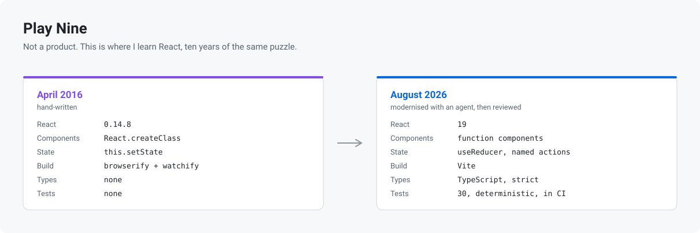

<picture>
  <source media="(prefers-color-scheme: dark)" srcset="assets/banner-dark.svg">
  
</picture>

# Play Nine

[](https://github.com/ViktorSoroka07/play-nine-game-react/actions/workflows/ci.yml)

This is not a product. It is where I learn React, and more recently where I
learned what working with an AI coding agent is actually like.

I wrote the first version by hand in April 2016 to teach myself React 0.14, and
I have rebuilt it in this same repository whenever the ecosystem moved far
enough to be worth relearning. The puzzle is beside the point. What the
repository holds is ten years of the same small feature, written by the same
person, while React changed underneath it.

## Ten years in one repository

|         | April 2016                         | August 2026                                      |
| ------- | ---------------------------------- | ------------------------------------------------ |
| React   | 0.14.8, `React.createClass`        | 19, function components                          |
| State   | `getInitialState`, `this.setState` | `useReducer` with named actions                  |
| Modules | `var React = require('react')`     | ES modules                                       |
| Build   | browserify, babelify, watchify     | Vite                                             |
| Types   | none                               | TypeScript, `strict`, `noUncheckedIndexedAccess` |
| Tests   | none                               | 30, deterministic, run in CI                     |

`React.createClass` was deprecated in React 15.5 and removed in 16. The early
commits here come from before hooks, before browsers ran ES modules, and from a
time when TypeScript was not yet a normal choice for a React app.

## What the 2026 rebuild taught me

Over three days in April 2026, an AI coding agent moved the project to Vite,
React 19, TypeScript and Vitest, wrote a test suite and split the documentation.
Agents are strong at this kind of job: a mechanical migration with a clear
target and plenty of public documentation behind it. By hand it would have taken
me much longer, and I would do it again.

What I took from it came later, when I sat down and read the result. The suite
was green, and a green suite only tells you the tests passed. Run repeatedly,
one test failed 2 of 5 runs, because it played against `Math.random()` instead
of scripting the draw. A 32-line solver had passing unit tests of its own and
was never called by the game, so the game ended one condition earlier than it
should have.

So this repository taught me two things rather than one. React, and that
generated code is still code: it earns trust by being read, not by arriving with
a green checkmark. The fixes are in
[`e53614a`](https://github.com/ViktorSoroka07/play-nine-game-react/commit/e53614a),
and the tests now script the random draw instead of playing against it.

## Run it

```sh
npm install
npm start          # dev server on http://localhost:8080
```

| Command             | What it does                 |
| ------------------- | ---------------------------- |
| `npm test`          | Vitest in watch mode         |
| `npm run coverage`  | tests with a coverage report |
| `npm run lint`      | ESLint                       |
| `npm run typecheck` | `tsc --noEmit`               |
| `npm run build`     | production build             |

CI runs lint, typecheck, coverage and build on pushes to `master` and on
pull requests.

## How to play

The board draws a number of stars. Pick the numbers from 1 to 9 that add up to
that count, then check the answer. Accept a correct answer and those numbers are
used up for the rest of the game, and a fresh draw follows.

You get five redraws. The game ends when you have used all nine numbers, or when
your redraws are gone and no combination of the numbers still on the board can
reach the current draw.

## License

MIT. See [LICENSE](LICENSE).
